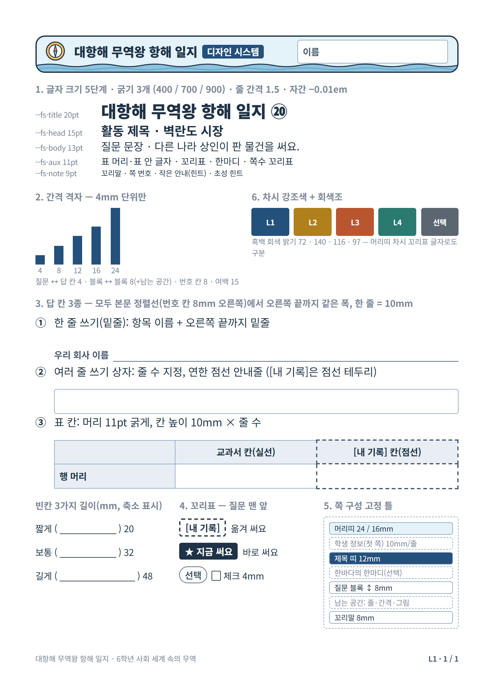

# 항해 일지 학습지 디자인 시스템 (작업 139)



토큰은 `design-system.css`, 부품은 `worksheet.css`, 쪽 틀·줄 채우기는 `common.js`에 있다.
`npm run worksheet:pdf`를 실행하면 규칙 검사도 함께 한다. 다음 경우에는 빌드가 실패한다.
- `font-size`·`margin`·`padding`·`gap`·`line-height`·`letter-spacing`에 토큰이 아닌 값을 쓴 경우. `var(--x, 대체값)`의 대체값도 검사한다.
- `font:` 줄임 속성이나 `!important`를 쓴 경우
- HTML `style=""`에 위 속성을 쓴 경우
- 번호 원 안쪽 여백이 2mm보다 작은 경우

PDF는 임시 폴더(`print/.dist-tmp`)에 먼저 만들고, 검사를 모두 통과했을 때만 `print/dist`로 복사한다.

## 1. 쪽 = 활동 하나
- 항해 기록(①~⑳) 하나가 A4 세로 한 쪽이다. 여백은 15mm이고, 본문 영역은 180×267mm다.
- 쪽은 다음 순서로 고정한다.
  1. **머리띠**: 차시 첫 쪽은 24mm짜리(제목·차시 꼬리표·차시 제목), 나머지 쪽은 16mm짜리(제목·차시 꼬리표·이름 칸)다.
  2. **학생 정보**: 차시 첫 쪽에만 둔다. 한 줄 쓰기 칸이 줄마다 10mm이고, 오른쪽에 깃발 그리기 칸(폭 40mm)이 있다.
  3. **활동 제목 띠**(12mm): 아이콘, 번호 원(14mm, 띠 위아래로 2mm씩 나옴), '항해 기록', 제목, 교과서 쪽수 꼬리표. 두 자리 번호는 자간 `--ls-num2`(−0.05em)로 원 안쪽 여백을 2mm 넘게 둔다. 마지막 글자 뒤 음수 자간만큼 오른쪽 여백을 되돌려(`padding-right: calc(-1 * var(--ls-num2))`) 시각 중앙에 맞춘다.
  4. 도입 한 줄이나 한바다의 한마디(선택).
  5. 질문 블록들.
  6. 꼬리말(8mm): 과목, 차시, 쪽 번호(예: `L1 · 2 / 4`).
- 남는 공간은 '7. 쪽 채움 규칙'에 따라 채운다(`common.js` `fill`).

## 2. 글자: 크기 5단계, 굵기 3개
| 토큰 | 크기 | 쓰는 곳 |
|---|---|---|
| `--fs-title` | 20pt | 머리띠 큰 제목, 번호 원 숫자 |
| `--fs-head` | 15pt | 활동 제목, 작은 머리띠 제목, 교사용 구역 제목 |
| `--fs-body` | 13pt | 질문·도입 문장 |
| `--fs-aux` | 11pt | 표 머리·표 안 글자, 꼬리표, 한마디, 쪽수 꼬리표, 풀이(용어 뜻) |
| `--fs-note` | 9pt | 꼬리말, 작은 안내(힌트), 초성 힌트, 글자 수 안내 |
- 굵기는 400(본문), 700(번호·제목·표 머리·꼬리표), 900(큰 제목·번호 원)만 쓴다.
- 줄 간격은 문장이 1.5, 한 줄짜리 꼬리표·띠가 1.2다. 빈칸이 있는 문장(`.fill`)은 줄 높이를 10mm로 한다.
- 자간은 −0.01em, 꼬리표는 0이다.

## 3. 간격: 4mm 격자
- 배치 간격은 4·8·12·16·24mm(`--sp-1/2/3/4/6`)만 쓴다.
  - 질문 문장과 답 칸 사이: 4mm
  - 질문 블록 사이: 모든 쪽에서 8mm. 남는 공간은 간격에 나눠 주지 않고 답 칸 줄 수가 흡수한다.
  - 머리띠, 학생 정보, 본문 사이: 4mm
- 1mm와 2mm(`--in-1/2`)는 꼬리표·칸·띠의 **안쪽 여백에만** 쓴다.
- **본문 왼쪽 정렬선**은 번호 칸(8mm) 오른쪽이다. 번호(1. 2. •)는 이 선 왼쪽에 걸고, 질문 문장·답 칸·표는 모두 이 선에서 시작해 오른쪽 끝(180mm)까지 같은 폭으로 쓴다.

## 4. 답 칸 3종(이것만 쓴다)
| 부품 | 클래스 | 모양 |
|---|---|---|
| ① 한 줄 쓰기 | `.a-line` + `.f` | 항목 이름 뒤에 오른쪽 끝까지 밑줄을 긋는다. 높이 10mm. 짧은 칸은 `.f.s`(12mm), `.f.m`(20mm) |
| ② 여러 줄 쓰기 상자 | `.a-box[data-lines=n]` | 실선 상자 안에 줄마다 10mm, 연한 점선 안내줄을 둔다. 상자 이름은 `.lab`(첫 줄 왼쪽) |
| ③ 표 칸 | `table.a-table`, 쓰는 칸 `td.w` | 칸 높이는 10mm × 줄 수, 머리는 11pt 굵게 연회색 바탕. **열 머리(thead)는 가운데, 행 머리(tbody th)는 늘 왼쪽 정렬**. 행에 `data-lines`를 주면 그 행의 빈칸이 모두 같이 늘어난다. 같은 표의 늘어나는 행은 묶어서 함께 늘려 행 높이를 같게 둔다 |
- **[내 기록]** 칸은 같은 부품에 점선 테두리를 쓴다: `.is-rec`(상자·밑줄), `.rc`(표). 점선(0.55mm)은 실선(0.35mm)보다 굵어서, 칸끼리 맞닿은 선에서도 점선이 보인다.
- 쓰는 칸 안의 안내(⑰ '수출액 1위 상품을 참고해요', ⑲ '라벨에 적힌 나라' 등)는 `.hint-top`으로 칸 오른쪽 위에 9pt로 작게 둔다. 이 안내 속 [내 기록]은 9pt 작은 꼬리표 `.tag.rec.in-hint`(가는 점선)를 쓴다. 칸 테두리에서 위 2mm, 오른쪽 4mm 떨어뜨린다. 쓰는 폭은 칸 전체다.
- 빈칸 ( ___ )은 3가지 길이만 쓴다: `.bl.s` 20mm, `.bl` 32mm, `.bl.l` 48mm. 초성 힌트는 `data-h`. '( ___ )조사'는 줄 끝에서 갈라지지 않게 자동으로 묶인다.
- 체크 네모는 4mm(`.cb`), 선택지는 `.choices`(가로) 또는 `.choices.col`(세로, 줄마다 10mm)로 쓴다.

## 5. 질문 블록
```html
<div class="q">
  <p class="q-text"><span class="q-no">2.</span><span class="tag now">★ 지금 써요</span>질문 문장 <span class="hint">(작은 안내)</span></p>
  <div class="a-box" data-lines="2" data-grow data-max="6"></div>
</div>
```
- 꼬리표 `.tag.rec`([내 기록], 점선), `.tag.now`(★ 지금 써요, 검은 바탕), `.tag.opt`(선택, 둥근 테두리)는 질문 문장 맨 앞 같은 자리에 같은 크기(11pt 굵게)로 쓴다. 문장 중간에 있던 꼬리표(⑱-1)만 `.tag.inline`으로 둔다.

## 6. 색
- 바탕은 회색조(남색 글자 `--ink`, 보조 `--ink-2`, 테두리 `--line`, 표 머리 `--head-bg`)다.
- 차시마다 강조색 1개를 쓴다: L1 남색, L2 황토, L3 주황, L4 청록, 선택 활동 회색. 활동 제목 띠, 차시 꼬리표, 한마디 왼쪽 줄에만 쓴다.
- 흑백으로 인쇄했을 때의 회색 밝기가 서로 다르다(약 72 / 140 / 116 / 97). 머리띠의 차시 꼬리표(L1 등) 글자로도 구분할 수 있다.
- [내 기록]은 색이 아니라 점선으로, ★ 지금 써요는 검은 바탕으로 구분한다.

## 7. 쪽 채움 규칙
남는 공간은 아래 순서로 채워서, 쪽 아래쪽이 텅 비지 않게 한다. 질문 문구는 새로 만들지 않는다.
1. **줄 늘리기**: `data-grow`가 붙은 답 칸(상자, 표의 행, ⑥ 흐름 칸, ⑫ 차례 칸)에 줄을 하나씩 고르게 늘린다. `data-max`까지 늘린다.
   - **같은 표의 행은 한 묶음**이다. 모든 행에 1줄씩 더할 자리가 있을 때만 함께 늘린다.
   - 빌드 검사: 같은 표 안의 늘어나는 행은 줄 수가 같아야 한다.
   - **칸 종류별 상한**: 표 행은 4줄, 여러 줄 상자와 흐름 칸은 6줄, 차례 칸은 3줄까지만 늘린다. 질문에 비해 칸이 지나치게 커지지 않게 하려는 것이다.
2. **자유 메모 · 그림 칸 (선택)**: 1을 상한까지 해도 90mm(쪽 본문의 약 1/3) 넘게 비는 쪽에 넣는다.
   - 지금 해당하는 쪽은 ② 121mm, ③ 94mm, ④ 102mm, ⑥ 112mm, ⑩ 105mm, ⑮ 185mm다. 빌드할 때마다 다시 판정하고 빌드 보고에 출력한다.
   - 1에서 늘린 줄 수를 처음으로 되돌린 뒤, 질문 블록 아래에 질문 블록 하나를 더 넣는다.
     - 머리말: `.tag.opt` '선택' 꼬리표 + '자유 메모 · 그림 칸'(11pt 굵게)
     - 칸: 여러 줄 쓰기 상자(`.a-box`, 줄 10mm, 연한 점선 안내줄). 안내줄이 있어 그림도 그릴 수 있다.
   - 다른 답 칸은 처음보다 2줄까지만 늘린다. 메모 상자는 그다음에 늘려서, 쪽 아래 바다 띠(24mm) 바로 위(띠와 4mm 간격)까지 채운다.
   - 이런 쪽에는 구름·갈매기를 넣지 않는다(상자와 겹치지 않게).
   - 빌드의 문구 대조에서는 이 블록(`.q.memo`)을 예외로 뺀다.
3. **줄 더 늘리기**: 메모 상자가 없는 쪽은 `data-max`를 6줄 더 풀어서(칸 종류별 상한까지) 남은 공간을 답 칸이 마저 흡수한다.
   - **블록 사이 간격은 늘 8mm로 둔다.** 남는 공간을 간격에 나눠 주지 않는다.
   - 10mm 미만의 자투리는 쪽 맨 아래에 남는다.
4. **바다 그림**: 그래도 30mm 넘게 남으면 쪽 아래에 바다 그림을 넣는다. 70mm 넘게 남으면 구름·갈매기도 넣는다.
   - 배는 어느 쪽에서든 물결 마루 위에 떠 있게 둔다(`.sea-art img.ship`).
- ⑰처럼 꽉 찬 쪽은 `data-noart`를 붙여 2~4번을 하지 않는다.
